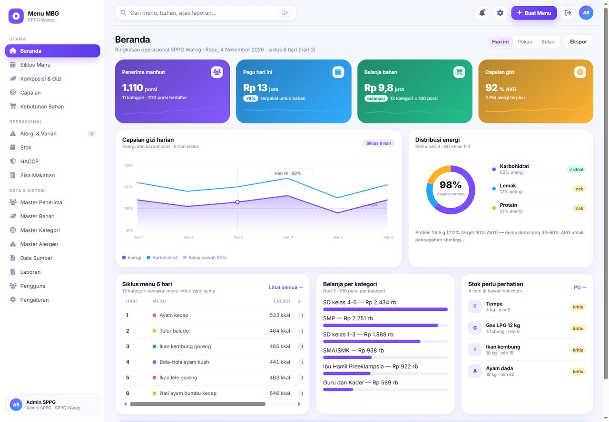
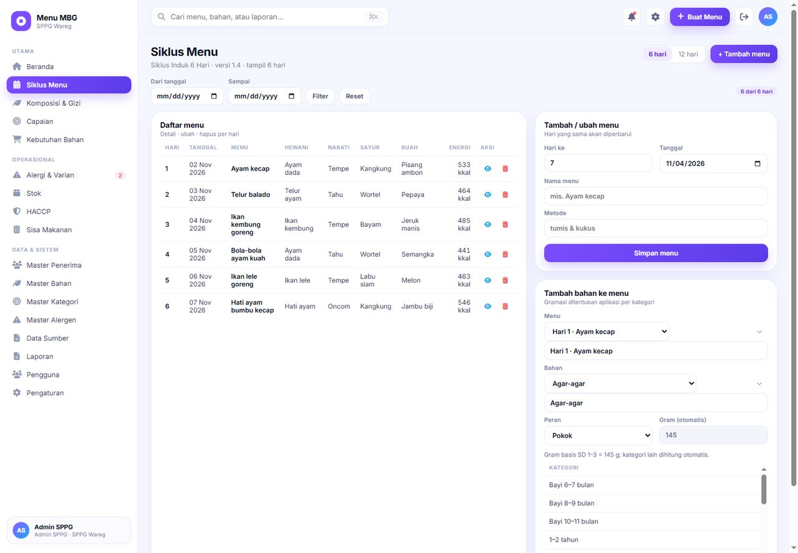
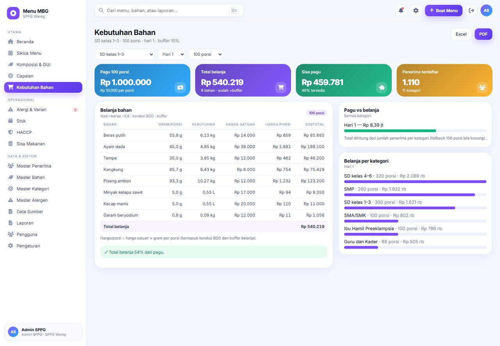
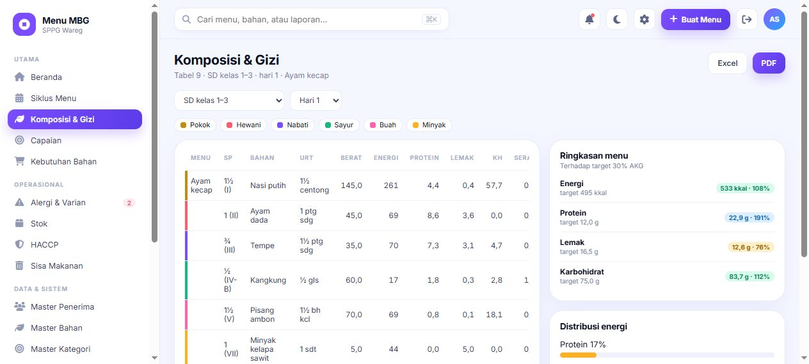
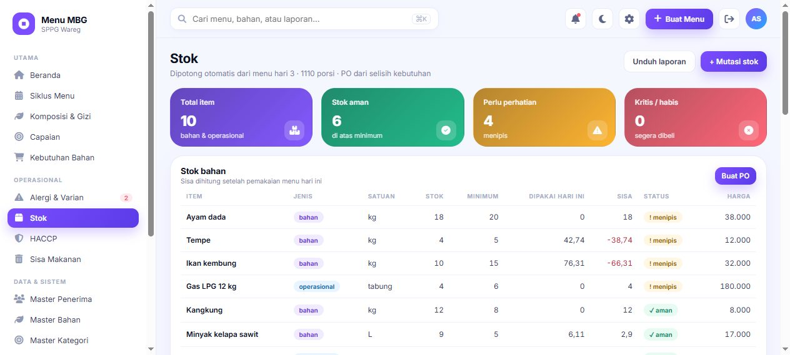
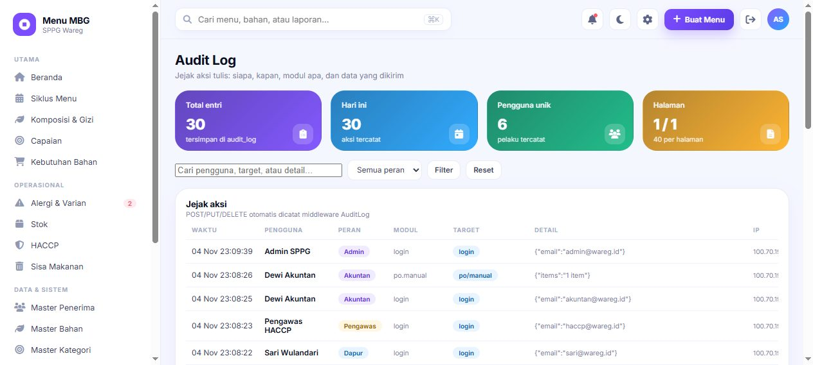
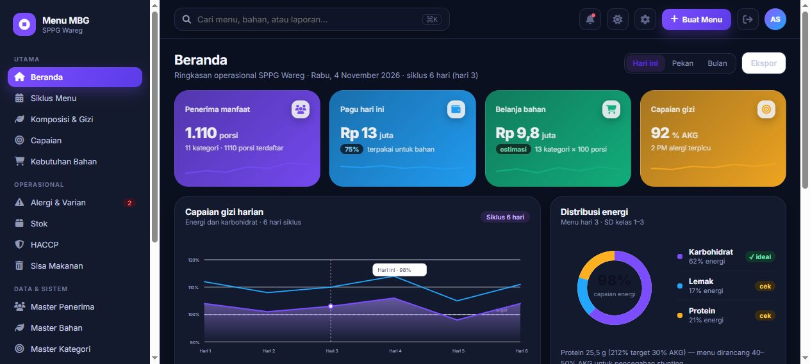

# Menu MBG — Aplikasi Perencanaan Menu SPPG

Aplikasi web untuk merencanakan siklus menu **Makan Bergizi Gratis (MBG)**, menghitung komposisi gizi,
kebutuhan bahan, deteksi alergi, dan operasional dapur SPPG dalam satu alur kerja.

Dibangun dengan **Laravel 13**, **MySQL 8**, dan CSS/templating tanpa build step npm. Seluruh perhitungan
gizi memakai basis data TKPI dan target 30% AKG per sajian.



## Fitur

- **Siklus menu 5/10 atau 6/12 hari** — pilih pola lewat Pengaturan, lengkap dengan tanggal, resep per hari, dan gramasi otomatis per kategori.
- **Komposisi & capaian gizi** — energi, protein, lemak, karbohidrat, serat, vitamin A/B, natrium;
  capaian terhadap target 30% AKG, ekspor PDF/Excel.
- **Kebutuhan bahan & belanja** — konversi nasi → beras (÷2,6), koreksi BDD, buffer 10%,
  harga per porsi, perbandingan pagu.
- **Deteksi alergi & varian** — 11 alergen, pemeriksaan per penerima manfaat per hari,
  aturan per kategori, varian preeklampsia rendah natrium.
- **Stok & PO** — mutasi stok, PO otomatis dari defisit, PO manual dengan qty/harga bebas,
  alur persetujuan `menunggu → disetujui → diterima` (stok bertambah otomatis).
- **HACCP & sisa makanan** — log titik kendali dan deviasi, pencatatan sisa per kelompok.
- **Master data berversi** — perubahan harga/gizi bahan dan jumlah penerima membuka periode baru;
  data dan laporan lama tidak ikut berubah.
- **Referensi** — 1.021 bahan TKPI, 121 bahan penukar (DBMP 8 golongan), harga acuan pasar,
  tarik harga PIHPS otomatis untuk 11 komoditas strategis.
- **Multi-peran** — admin, ahli gizi, petugas dapur, pengawas, akuntan; audit log setiap aksi tulis.
- **Lainnya** — tema gelap, pencarian dropdown, antrian tulis offline untuk HACCP/sisa, cache Beranda.

## Tangkapan layar

| Siklus menu | Kebutuhan bahan |
|---|---|
|  |  |

| Komposisi gizi | Stok & PO |
|---|---|
|  |  |

| Audit log | Tema gelap |
|---|---|
|  |  |

## Stack

- PHP 8.3 · Laravel 13
- MySQL 8 (utf8mb4)
- Blade + CSS tulis tangan, Font Awesome 6.5.2 lokal (tanpa CDN)
- dompdf & PhpSpreadsheet untuk ekspor
- Tanpa Node/npm untuk runtime

## Instalasi

Prasyarat: PHP 8.3+ (`pdo_mysql`, `mbstring`, `zip`, `gd`), Composer, MySQL 8.

```bash
git clone https://github.com/gnosprinting/mbg-menu-app.git
cd mbg-menu-app
composer install
cp .env.example .env
php artisan key:generate
```

Buat database, lalu sesuaikan `.env`:

```dotenv
DB_CONNECTION=mysql
DB_HOST=127.0.0.1
DB_PORT=3306
DB_DATABASE=mbg
DB_USERNAME=mbg
DB_PASSWORD=rahasia
```

```bash
php artisan migrate --seed
php artisan mbg:import-tkpi     # 1.021 bahan dari database/data/tkpi.csv
php artisan mbg:isi-harga       # isi harga bahan yang masih 0
php artisan storage:link
php artisan serve
```

Buka `http://127.0.0.1:8000`.

### Akun demo

| Peran | Email | Sandi |
|---|---|---|
| Admin SPPG | `admin@wareg.id` | `password` |
| Ahli gizi | `rina@wareg.id` | `password` |
| Petugas dapur | `sari@wareg.id` | `password` |
| Pengawas | `haccp@wareg.id` | `password` |
| Akuntan | `akuntan@wareg.id` | `password` |

> Ganti seluruh sandi demo sebelum dipakai di produksi.

## Perintah berguna

```bash
php artisan mbg:tarik-harga      # tarik harga PIHPS (11 komoditas)
php artisan mbg:isi-harga        # terapkan harga acuan ke bahan berharga 0
php artisan migrate:fresh --seed # reset database + data contoh
```

## Struktur

```
app/
  Http/Controllers/   PageController (baca), ActionController (tulis), ExportController
  Services/           Nutrition, Belanja
  Console/Commands/   ImportTkpi, TarikHarga
database/
  migrations/         skema + periode master + persetujuan PO
  seeders/            MbgSeeder, ReferenceSeeder, UserSeeder
  data/tkpi.csv       data gizi TKPI
resources/views/      Blade per modul
public/js/            search-select.js, offline-queue.js
tests/                PHPUnit
```

## Deployment

Panduan hosting (MySQL, document root `public/`, cron, backup, keamanan) ada di
[DEPLOY_HOSTING.md](DEPLOY_HOSTING.md).

## Lisensi

[MIT](LICENSE) © 2026 Anjar
